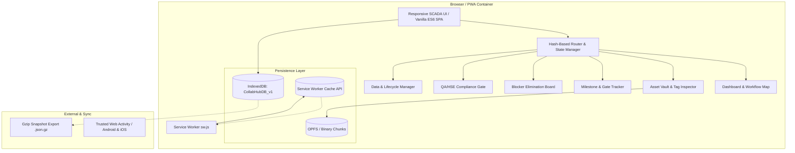

<div align="center">

# ⚙️ CrossTeam CollabHub PWA
### Centralized Asset, Milestone & Compliance Hub for SCADA & Industrial Automation
** Dubai, U.A.E.**

[](https://web.dev/progressive-web-apps/)
[](https://developer.mozilla.org/en-US/docs/Web/API/IndexedDB_API)
[](https://www.aveva.com/)
[](LICENSE)

*An enterprise-grade, offline-first Progressive Web App engineered for SCADA Engineers to execute cross-functional project collaboration across Estimation, Procurement, PLC Engineering, SCADA Development, QA/HSE, and Client Stakeholders.*

</div>

---

## 📊 System Architecture

The application is built on a resilient, client-side architecture featuring a multi-store IndexedDB persistence layer, Origin Private File System (OPFS) support, Background Sync queues, and a Service Worker optimized with 2026 Static Routing API primitives.



---

## 🚀 Quick Start & Running Locally

Because this application operates as a secure, offline-first Progressive Web App, it requires a local web server or HTTPS environment to register its Service Worker properly.

1. **Clone or Download** the project repository.
2. **Serve the Directory** using any static web server:
   ```bash
   python -m http.server 8080
   ```
3. **Open in Browser**: Navigate to `http://localhost:8080` in Chrome, Edge, or Safari.
4. **Install as App**: Click the **"Install App"** button in the top navigation bar or browser URL bar to install it as a standalone desktop/mobile app.

---

## 🏗️ Core Modules & Functional Specifications

| Module | Purpose & Industrial Features |
| :--- | :--- |
| **Dashboard** | Executive Command center with real-time KPIs (`Active projects`, `Milestones %`, `Open blockers`, `Hours vs Budget`, `Storage Quota`) and an interactive **Cross-Functional Workflow Map** (`Estimation` → `Procurement` → `PLC` → `SCADA` → `QA/HSE` → `Client`). |
| **Asset Vault** | Central repository for PLC Modbus register maps, Wonderware tag DBs, OPC UA topologies, and SQL query templates. Features inline status dropdowns (`Approved`, `In Review`, `Draft`, `Blocker Flagged`), SHA-256 integrity hashes, file previews, and download/delete actions. |
| **Milestones** | End-to-end gate pipeline with prerequisite dependency validation (`⚠ Prerequisite not Done`), 3-step handoff verification (`Deliverable prepared`, `Peer reviewed`, `Handed to next team`), and date tracking. |
| **Blockers** | Cross-team impediment tracker measuring impact in working hours and AED expenditures, complete with severity ratings, an interactive resolution workflow, and a scrollable event broadcast log with export capabilities. |
| **QA/HSE Gate** | Mandatory compliance checklist enforcing strict adherence to **Annexure-SCT-HR-001** (FAT/SAT protocols, cybersecurity checks, legal paperwork). Unlocks a printable formal compliance sign-off certificate upon 100% completion. |
| **Data & Lifecycle** | Storage telemetry dashboard (`10 GB` quota monitor, store record counts), full workspace Gzip snapshot export/import (`.json.gz`), project archiver/restorer, and one-click demo data reset. |

---

## 📈 Version Evolution & Release Notes

- **v2**: Introduced the New Project modal, Archive Manager (with restore capabilities), searchable/paginated asset vault with preview/download/delete, project switcher, human-readable milestone dependencies, resolved-blocker history, storage analytics, backup reminders, and demo reset.
- **v4**: Added real seeded engineering files (`CSV`/`JSON`/`SQL`) with searchable preview, hours/AED logging, blocker project column & filter, synced milestone status/checklists, readable store names, and the QA/HSE printable sign-off certificate.
- **v5**: Upgraded to a wider layout (`1440px`), compact action icons + hash badges, custom dark scrollbars, file storage via IndexedDB chunks, styled custom file pickers, status-coloured select dropdowns, an interactive workflow map, guided onboarding tour, settings drawer, and mobile card table fallback.
- **v6**: Consolidated architecture by merging `upgrade.js` directly into core modules, implemented full-offline precache list, active filter pill + Done/Active/Pending map counters, QA/HSE progress + locked/unlocked states, and scrollable broadcast log with Clear/Export actions.
- **v7**: Restructured the top-right storage pill with live synchronization, deployed a symmetrical `5x2` storage grid on the Data tab, optimized QA/HSE spacing, sorted the Asset Vault deterministically by ID, and added prerequisite milestone warning badges.

---

## 🗄️ Storage & Data Lifecycle Architecture

- **Database Engine**: IndexedDB (`CollabHubDB_v1`) utilizing compound indexes across 9 object stores (`projects`, `milestones`, `assets_meta`, `assets_chunks`, `tasks_blockers`, `hours_expenditures`, `qa_hse_audits`, `activity_log`, `archives`).
- **Persistence**: Automatically requests persistent storage via `navigator.storage.persist()` to protect critical engineering data from browser eviction over a 2–3 year operational lifecycle.
- **Backups**: Gzip snapshot export generates portable `.json.gz` backups (excluding large binary attachments to keep snapshot files lightweight).

---

## 🛠️ Deployment & TWA Configuration Note

- **Static Routing**: The Service Worker (`sw.js`) uses root-relative `/icons/*` static routing. Adjust the paths if hosting within a sub-directory or GitHub Pages sub-path (e.g., `/CrossTeam-CollabHub/`).
- **Trusted Web Activities (TWA)**: If packaging this PWA for the Google Play Store or Apple App Store, ensure you replace the placeholder certificate fingerprint in `.well-known/assetlinks.json` with your organization's actual release signing key SHA-256 fingerprint.

---

<div align="center">

*Engineered with precision for industrial automation excellence.*

</div>
